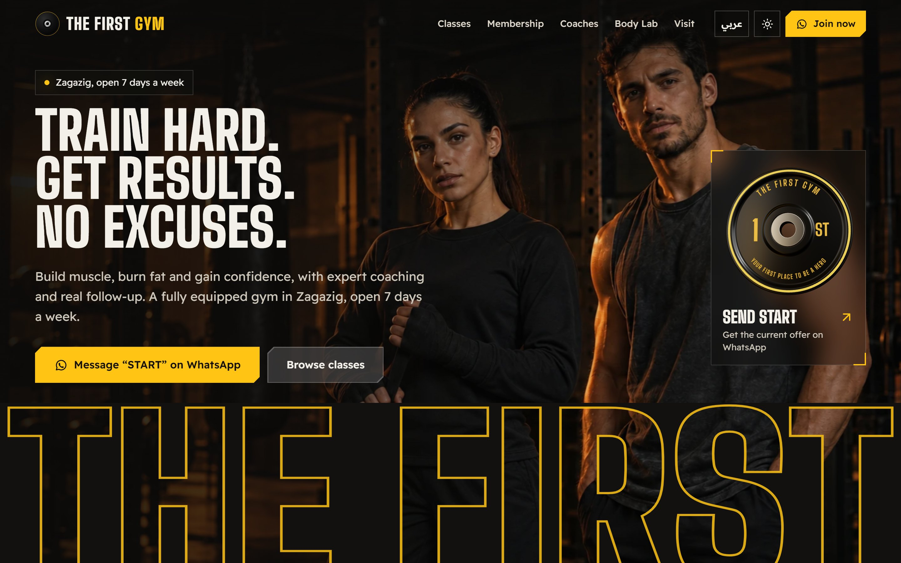
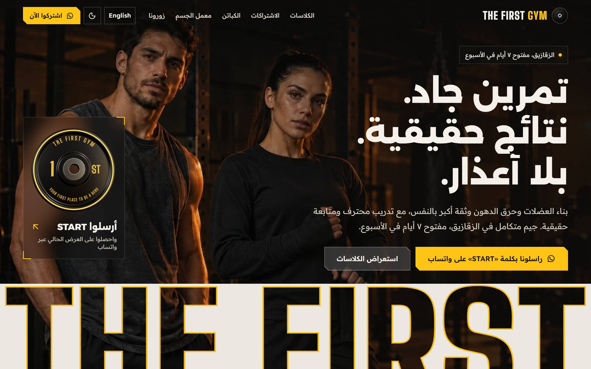
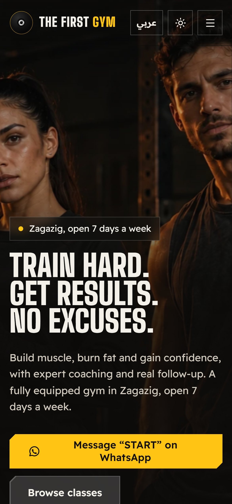

# The First Gym

Website for **The First Gym** in Hay El Mostasharin, Zagazig: classes and a weekly timetable, coaches, membership with a plan finder, body calculators, opening hours and directions. English and Arabic, dark and light.

**Live:** [the-first-gym.vercel.app](https://the-first-gym.vercel.app)



| Arabic, light theme | Phone |
| --- | --- |
|  |  |

## What's on it

- **Hero.** A full-bleed photo that flickers on like the gym's lights, the gym's own tagline ("Train hard. Get results. No excuses."), and the name cut out of the page as a stencil with the photo showing through the letters. A glass card holds the gym's plate in 3D (three.js loads only for it, and a flat drawing stands in until it's ready or if WebGL isn't available).
- **Crossed caution tape** under the hero, with the facilities and classes running along it.
- **Classes.** A picker on the home page (class names on one side, the class photo, coach and published times on the other), plus a full list with a filter by who each class is for and a Saturday-to-Friday timetable that highlights today in Cairo time.
- **Membership.** Cards for the 1, 3, 6 and 12-month plans, and a four-question plan finder that suggests classes and opens WhatsApp with a ready message starting with START, the word the gym asks for.
- **Body Lab.** BMI with the WHO bands, daily calories (Mifflin-St Jeor) and a protein range. Accepts Arabic-Indic digits and points visitors to the gym's InBody scans.
- **Visit.** Directions to the gym's Google Maps pin, call, WhatsApp, Instagram and Facebook links, opening hours with a live "open now" line, and questions answered from the gym's own posts.
- **English and Arabic** with full right-to-left layout, Arabic-Indic digits and plural forms. Arabic copy addresses visitors in the plural, so it reads the same for everyone.
- **Dark and light themes**, an animations switch in the footer (it starts from the system's reduced-motion setting), keyboard focus that follows page changes, and a styled scrollbar.

## Facts and placeholders

Every fact lives in [`src/data/gym.js`](src/data/gym.js), taken from the gym's [Facebook page](https://www.facebook.com/TheFirstGym1) and its Google Maps listing. Nothing is invented: anything the gym hasn't published is `null` and shows on the site with a strip of hazard tape and "To be added". Still to come from the gym:

- Membership prices
- Opening hours confirmation (the times come from Google Maps; Facebook only says "open 7 days a week"). Set `hours.confirmed` to `true` once confirmed.
- Days and times for MMA, Zumba, Aerobics, Yoga and Dance, and the Kickboxing time
- The rest of the coaching team, coach photos, photos of the gym and the logo file

## Photos

The two athlete photos (`src/assets/athletes-*.webp`) were supplied for the site. Everything in `src/assets/stock/` is a placeholder from [Unsplash](https://unsplash.com), free to use under the [Unsplash License](https://unsplash.com/license), and the site tags each one "Sample photo" until the gym's own photos replace it (see `src/lib/photos.js`).

| File | Photographer | Photo |
| --- | --- | --- |
| class-fitness | Akram Huseyn | [photo-1649789248266](https://images.unsplash.com/photo-1649789248266-ef1c7f744f6f) |
| class-kickboxing | Anastase Maragos | [photo-1765303193537](https://images.unsplash.com/photo-1765303193537-ae41f1a3720f) |
| class-mma | Daniil Zanevskiy | [photo-1611077479643](https://images.unsplash.com/photo-1611077479643-5b3c01381f9e) |
| class-zumba | Chris Yang | [photo-1593105722399](https://images.unsplash.com/photo-1593105722399-0ee263656fdd) |
| class-aerobics | Jessica Streser | [photo-1731325632701](https://images.unsplash.com/photo-1731325632701-90d4e869a98e) |
| class-yoga | Ginny Rose Stewart | [photo-1599901860904](https://images.unsplash.com/photo-1599901860904-17e6ed7083a0) |
| class-dance | Danielle Cerullo | [photo-1524594152303](https://images.unsplash.com/photo-1524594152303-9fd13543fe6e) |
| coach-osama | Samuel Girven | [photo-1704223523169](https://images.unsplash.com/photo-1704223523169-52feeed90365) |
| coach-tamer | Vitaly Gariev | [photo-1758875568932](https://images.unsplash.com/photo-1758875568932-0eefd3e60090) |
| coach-nada | Logan Weaver | [photo-1590556409324](https://images.unsplash.com/photo-1590556409324-aa1d726e5c3c) |
| facility-train | Salman Sidheek | [photo-1778828494354](https://images.unsplash.com/photo-1778828494354-9b717d36dc99) |
| facility-recover | HUUM | [photo-1660735698223](https://images.unsplash.com/photo-1660735698223-23a4edefa264) |
| facility-practical | Alex Lion | [photo-1781274326569](https://images.unsplash.com/photo-1781274326569-7120016a6c7e) |
| head-classes | Ahmad Thomas | [photo-1758778932703](https://images.unsplash.com/photo-1758778932703-7bfaaf1c42cd) |
| head-membership | Samuel Girven | [photo-1576678927484](https://images.unsplash.com/photo-1576678927484-cc907957088c) |
| head-coaches | Mirko Meister | [photo-1784798228092](https://images.unsplash.com/photo-1784798228092-659924b1a15b) |
| head-body-lab | i yunmai | [photo-1522844990619](https://images.unsplash.com/photo-1522844990619-4951c40f7eda) |
| head-visit | Salman Sidheek | [photo-1778828450059](https://images.unsplash.com/photo-1778828450059-f39d5bbb01af) |

## Stack

React 19, JavaScript, Vite, React Router, three.js with React Three Fiber, Vitest with Testing Library, ESLint, and GitHub Actions (lint, test and build on every push). Fonts are self-hosted: Big Shoulders Display for English headings, Alexandria for Arabic headings, Readex Pro for text.

## Scripts

```bash
npm install
npm run dev      # local server
npm test         # 50 tests
npm run lint
npm run build    # production build in dist/
```

## Deploying

`vercel.json` serves the single-page app and sends security headers, including a Content-Security-Policy that allows the one inline script in `index.html` (it applies the saved language and theme before the first paint) by its hash. If that script changes, update the hash; `src/test/csp.test.js` fails until they match.
